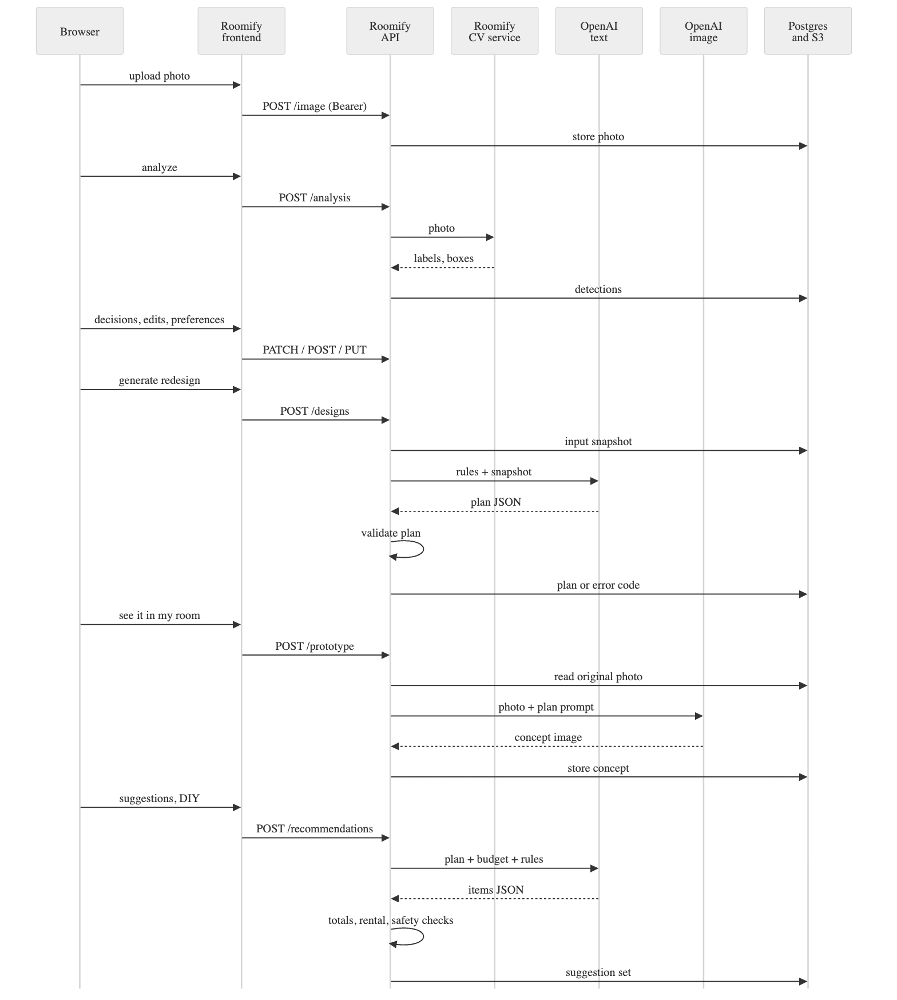
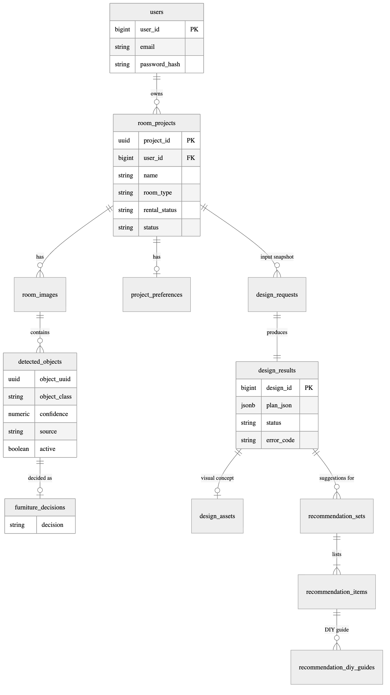

# Architecture

Roomify turns one photo of a person's own room into a saved, budget-aware and rental-aware redesign
project. It is built as three services — a web frontend, an API and a computer-vision service — plus
PostgreSQL, object storage and the OpenAI API. This document describes how they fit together, how a
request flows through them, what is stored, and how privacy is enforced.

## System overview

| Component | Technology | Responsibility |
|---|---|---|
| Roomify frontend | Next.js 15.5, React 19, TypeScript, Tailwind CSS | Pages for the whole journey; same-origin route handlers (`/api/*`) that keep the access token in an httpOnly cookie and forward it to the API as a Bearer token |
| Roomify API | Spring Boot 3.5, Java 21 | Accounts and ownership, project workflow, image storage, calls to the CV service and OpenAI, and all validation of generated output |
| Roomify CV service | FastAPI, Ultralytics YOLO11n | Detects six furniture classes in a photo; reachable only by the API |
| PostgreSQL 17 | Flyway migrations V1–V10 | Users, projects, detections, decisions, preferences, design history, suggestions, DIY guides |
| Object storage | AWS S3 (local disk in development) | Original room photos and generated concept images |
| OpenAI API | Chat Completions (`gpt-4o-mini`), Images edits (`gpt-image-2.5-sunburst`) | Redesign plans, suggestions and DIY guides as JSON; the visual concept |

The browser never calls the API or the CV service directly and never sees the access token. All
three services ship as pinned container images.

## Request flow

1. **Upload.** The photo is validated (JPG or PNG, size and signature), stored, and linked to the project.
2. **Analysis.** The API sends the photo to the CV service and stores each detection with a stable UUID.
3. **Review.** The person sets Keep, Replace, Remove or Unsure per item and can rename, remove or add
   items; added and renamed items are marked as user-confirmed.
4. **Preferences.** Style, colours, purpose, budget, Rental-Friendly Mode and free-text requirements.
5. **Plan.** The API stores an immutable input snapshot, asks the text model for a plan in a fixed JSON
   schema, then validates it in code: every item with its saved decision, matching instructions, exact
   budget arithmetic within the budget, no permanent work in rental mode, uncertainty wording for
   low-confidence items. One corrective retry; otherwise the attempt is stored as failed with a code.
6. **Visual concept.** The photo recorded in the snapshot is edited by the image model with a prompt
   derived from the validated plan, then stored.
7. **Suggestions and DIY.** The text model proposes items; the API rounds prices, computes totals,
   checks cheaper alternatives and rental wording, and stores the set. DIY guides must be beginner
   level, cost no more than buying, and pass a safety filter.

No database transaction stays open while a provider is working, and nothing partially generated is
ever shown.

## Data model

Each generation keeps the exact input it was made from (`design_requests.input_snapshot`), the provider,
model and prompt version, the outcome and a stable error code. Detections are never deleted, only
deactivated, so design history stays explainable. Money is stored as `NUMERIC(12,2)` and handled as
`BigDecimal`; database CHECK constraints repeat the most important rules (totals, statuses, currency).

## Security and privacy

| Concern | Design |
|---|---|
| Authentication | Email and password (BCrypt); stateless HS256 access tokens, 1 hour by default |
| Token handling | Stored only in an httpOnly, SameSite=Lax cookie (Secure in production) set by the frontend's route handlers |
| Authorisation | One rule covers every `/api/projects/{id}/**` route; another user's project returns the same 404 as a missing one |
| Generated content | Treated as untrusted input; validated before storage; provider error messages never shown or logged |
| CV service | No public address; its `image_url` input rejects non-public targets (SSRF) and does not follow redirects |
| Secrets | Only `.env.example` files in git; full history scanned with no findings |

## Deployment topology (proposed)

This topology is a proposal; nothing has been deployed. Costs, steps and risks are in the Deployment
document.

## Architectural decisions

| Decision | Reason |
|---|---|
| Three services instead of one | Keeps PyTorch out of the JVM host, lets the CV service stay private, and lets each part scale or be replaced independently |
| Backend-for-frontend bridge in Next.js | The token never reaches browser JavaScript; no CORS surface on the API |
| "The model proposes, the server disposes" | LLM output is checked by deterministic code before it is stored or shown |
| Immutable input snapshots | The concept always matches its plan; changed inputs mid-generation are detected |
| Model names are configuration | OpenAI retired one model during the build; switching needs no code change |
