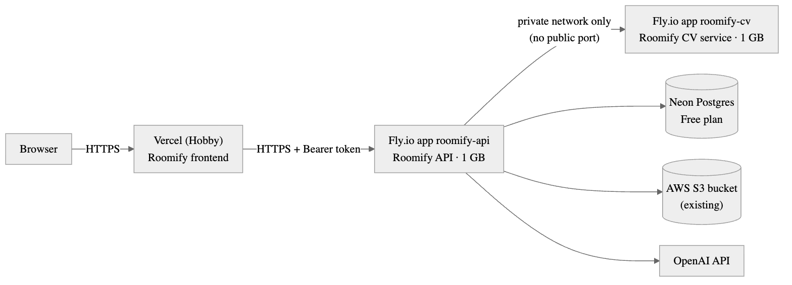

# Deployment

**Status: proposal only.** No cloud resources have been created. Every step below needs the project
owner's approval and their own credentials.

## Recommendation: Vercel + Fly.io + Neon + existing S3



Why this shape:

- **Each service already ships as a container** (backend and CV Dockerfiles are pinned and tested),
  so the hosts only run images: no build-system work.
- **The CV service gets no public address.** It has no authentication and an `image_url` input;
  Fly's private network lets only the backend reach it.
- **Long AI calls fit.** Image edits can take up to ~2 minutes. Vercel Hobby functions with Fluid
  compute allow 300 s; the backend's AI timeout is 180 s. The browser never calls the backend directly
  (the Next bridge does), so no CORS changes are needed.
- **Measured memory fits 1 GB machines:** CV container 374 MiB after inference, backend 424 MiB
  after start-up (Docker, 2026-10-24).

## Cost (list prices checked 2026-10-24)

| Piece | Plan | Monthly |
|---|---|---|
| Frontend | Vercel Hobby (personal/non-commercial — fine for judging) | $0 |
| Backend | Fly.io shared-cpu-1x, 1 GB, always on, `iad` | $6.70 |
| CV service | Fly.io shared-cpu-1x, 1 GB, always on, `iad` | $6.70 |
| Database | Neon Free (0.5 GB storage, scales to zero after 5 min idle) | $0 |
| Images | Existing AWS S3 bucket (Standard ≈ $0.023/GB-month) | < $0.10 |
| **Infrastructure total** | | **≈ $13.40 / month** |
| OpenAI usage | per redesign: plan + concept + suggestions + DIY | **Pending: requires OpenAI key** (EVALUATION.md §2) |

Notes: Fly bills per second, so stopping the machines after judging stops the cost. Fly raised its
RAM price on 2026-10-01 (1 GB machine $5.70 → $6.70); Frankfurt is $7.73. Neon's first query after
idling has a cold start of up to a few seconds. Sources: [Fly.io pricing](https://docs.fly.io/about/pricing),
[Vercel function limits](https://vercel.com/docs/functions/limitations), [Neon pricing](https://neon.com/pricing).

## Steps (to run after approval)

Prerequisites the owner provides: Fly.io account (`fly auth login`), Vercel account linked to the
GitHub org, Neon account, the existing S3 bucket name/region and an IAM key **scoped to that bucket**,
an OpenAI key.

1. **Database** — Neon console → *New project* `roomify` (region AWS us-east-1) → copy host, database,
   user, password.
2. **CV service** (private):
   ```bash
   cd roomify_cv
   fly launch --name roomify-cv --region iad --no-deploy --internal-port 8000
   # remove the [http_service] section from fly.toml so it has no public port
   fly scale vm shared-cpu-1x --memory 1024 -a roomify-cv
   fly deploy -a roomify-cv
   ```
3. **Backend**:
   ```bash
   cd roomify_backend
   fly launch --name roomify-api --region iad --no-deploy --internal-port 8080
   fly secrets set -a roomify-api \
     DB_HOST=<neon-host> DB_PORT=5432 DB_NAME=<db> DB_USERNAME=<user> DB_PASSWORD=<password> \
     JWT_SECRET=$(openssl rand -hex 32) OPENAI_API_KEY=<key> \
     STORAGE_TYPE=s3 S3_BUCKET=<bucket> AWS_REGION=<region> AWS_ACCESS_KEY_ID=<id> AWS_SECRET_ACCESS_KEY=<secret> \
     CV_SERVICE_URL=http://roomify-cv.internal:8000
   fly scale vm shared-cpu-1x --memory 1024 -a roomify-api
   fly deploy -a roomify-api
   curl https://roomify-api.fly.dev/api/health
   ```
   Neon requires TLS; if the JDBC URL needs it explicitly, add `?sslmode=require` via a
   `SPRING_DATASOURCE_URL` secret.
4. **Frontend** — Vercel → *Add New Project* → import `Bootcamp2Roomify/roomify_frontend` → framework
   Next.js → environment variable `ROOMIFY_API_URL=https://roomify-api.fly.dev` → *Deploy*.
5. **Smoke test** — run the live browser suite against the deployment:
   `LIVE_BASE_URL=https://<project>.vercel.app LIVE_AI=1 npx playwright test -c playwright.live.config.ts`.
6. **After judging** — `fly scale count 0 -a roomify-api -a roomify-cv` (stops billing), or `fly apps destroy`.

## Risks

- `gpt-4o-mini` (default text model) is shut down by OpenAI on **2027-01-14**; switch to
  `gpt-6-luna` with `AI_TEMPERATURE=` and `AI_REASONING_EFFORT=low` before then (config only).
- Vercel Hobby is for non-commercial use; move to Pro ($20/month) for anything beyond judging.
- A public demo can spend the OpenAI budget: set a monthly usage limit in the OpenAI dashboard.
