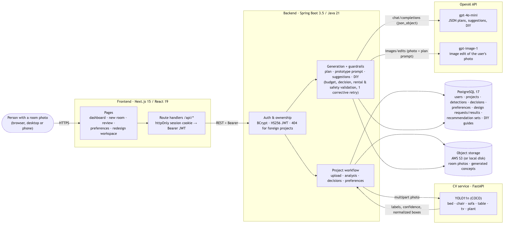
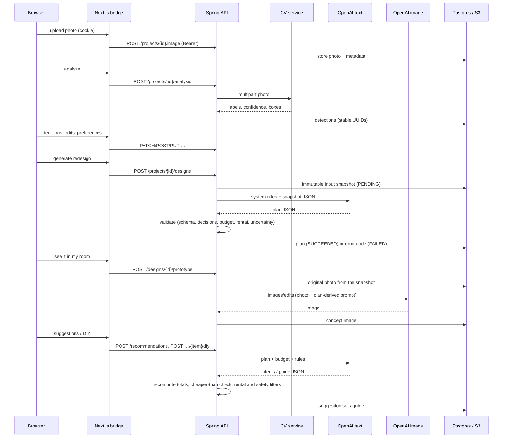

# Roomify — technical report

*Redesign more, buy less.* Devpost: <https://devpost.com/software/roomify-hsc4yn> ·
Code: [backend](https://github.com/Bootcamp2Roomify/roomify_backend) ·
[CV service](https://github.com/Bootcamp2Roomify/roomify_cv) ·
[frontend](https://github.com/Bootcamp2Roomify/roomify_frontend)

> Status of this report (2026-10-24): everything below is implemented, merged and tested. The
> generation results in §6.2 are **not yet measured** because no OpenAI key was configured on the
> evaluation machine; they are left blank rather than estimated.

## 1. Problem

People who most want to improve their room — students, renters, young adults on small budgets —
are the least served by existing tools ([scope](scope.md)):

1. **They can't picture a redesign in their own room.** Inspiration sites show other people's spaces.
2. **They can't see the total cost**, or what to cut when a plan is over budget.
3. **They often can't drill, paint or replace flooring**, yet most ideas assume they can.
4. **Usable furniture gets replaced** instead of kept, moved, repaired or upcycled.

## 2. Approach

One photo of the real room becomes one organised, saved project:

1. **Detect** the major furniture in the photo (computer vision).
2. **Let the person correct and decide**: Keep, Replace, Remove or Unsure per item; rename, remove or
   add items the detector got wrong. Detection is treated as a draft, not ground truth.
3. **Collect constraints**: style, colours, room purpose, maximum budget, Rental-Friendly Mode
   (on by default for renters and dorms), free-text requirements.
4. **Generate a plan with an LLM, then verify it in code**: every kept item is kept, every removed
   item removed, the costs add up and fit the budget, rental mode contains no permanent work. A plan
   that breaks a rule is retried once with the reason, otherwise rejected — never shown.
5. **Render a visual concept** by editing the person's own photo with an image model, guided by the
   verified plan.
6. **Suggest purchases and DIY** within the budget: estimated price, placement, reason, a cheaper
   alternative, and beginner DIY guides that pass a safety filter.
7. **Save everything** under the person's account; the dashboard reopens any project where it stopped.

The design principle is *the model proposes, the server disposes*: LLM output is untrusted input that
must pass deterministic validation before it is stored.

## 3. System design

Source: [`architecture/architecture.mmd`](architecture/architecture.mmd).

| Service | Stack | Responsibility |
|---|---|---|
| Frontend | Next.js 15.5, React 19, TypeScript, Tailwind | Pages; a same-origin bridge (`/api/*` route handlers) that keeps the JWT in an httpOnly cookie and forwards it as a Bearer token |
| Backend | Spring Boot 3.5, Java 21, PostgreSQL 17 + Flyway | Auth and ownership, workflow state, storage, provider calls, all validation |
| CV service | FastAPI, Ultralytics YOLO11n | Furniture detection; private, called only by the backend |
| Storage | AWS S3 (or local disk) | Room photos and generated concepts |
| AI | OpenAI | Plans, suggestions, DIY (text); concept image (image edits) |

### 3.1 Data flow

### 3.2 Data model (main tables)

`users` → `room_projects` (owner, name, room type, rental status, workflow status) →
`room_images` → `detected_objects` (stable UUID, source CV/MANUAL, active flag) → `furniture_decisions`;
`project_preferences`; `design_requests` (immutable input snapshot, provider, prompt version) →
`design_results` (plan JSON, status, error code) → `design_assets` (concept image);
`recommendation_sets` → `recommendation_items` → `recommendation_diy_guides`. Ten Flyway migrations.

## 4. Models and providers

| Task | Model | Why | Settings |
|---|---|---|---|
| Furniture detection | Ultralytics **YOLO11n**, COCO-pretrained | Runs on CPU in ~32 ms, 5 MB, no training needed | confidence ≥ 0.25; six classes kept: bed, chair, sofa, table, tv, plant |
| Plan, suggestions, DIY | OpenAI **gpt-4o-mini** (Chat Completions, `json_object`) | Cheapest model that follows long JSON schemas | temperature 0.1, ≤ 4000 output tokens, 1 corrective retry |
| Visual concept | OpenAI **gpt-image-2.5-sunburst** (`images/edits`) | Edits the user's real photo; OpenAI's replacement for the retired `gpt-image-1`, positioned for precise edits | 1024×1024, quality `low` |

Model names are configuration. Two provider facts discovered during the build changed the defaults:
`gpt-image-1` was shut down by OpenAI on 2026-10-23, and `gpt-4o-mini` shuts down on 2027-01-14 (its
replacement `gpt-6-luna` is a reasoning model; the request code now supports it by configuration).

## 5. Key decisions

1. **Detection is a draft.** COCO has no desk, wardrobe, shelf or lamp class, and measured recall is
   0.62 (§6.1). So the review step supports rename, remove and add, low-confidence items are flagged,
   and analysis failure offers manual entry instead of a dead end.
2. **Validate generated output in code.** Plans must contain every detected item exactly once with its
   saved decision; instructions must match the decision ("Keep …", "Replace …"); allocations must sum
   exactly to the total and fit the budget (BigDecimal); rental plans are scanned for permanent work;
   low-confidence and Unsure items need uncertainty wording. Suggestions get server-computed totals and
   strictly-cheaper alternatives; DIY guides are Beginner/Easy, cheaper than buying, and rejected if they
   mention electrical, plumbing, gas or structural work.
3. **Immutable input snapshots.** Each generation stores exactly what the model saw (detections,
   decisions, preferences, image reference). The concept is rendered from the snapshot's photo, so it
   always matches its plan, and a design whose inputs changed mid-generation is rejected.
4. **Privacy by construction.** One authorization rule covers every `/api/projects/{id}/**` route;
   another user's project is indistinguishable from a missing one (404). The browser never holds the
   JWT. The CV service is designed to stay off the public internet, and its `image_url` input refuses
   non-public addresses (SSRF).
5. **Estimates, said plainly.** Prices, totals and the concept image are labelled as estimates and
   concepts everywhere they appear; the plan page states it is not a professional plan.
6. **Budget warnings that stay true.** Stored suggestions always fit the budget at generation time; if
   the person lowers the budget later, the summary warns and shows what switching to the cheaper
   options would save.

## 6. Results

### 6.1 Detection (measured)

60 COCO val2017 indoor images (held out from training), 159 objects, matched at IoU ≥ 0.5 through
the product's HTTP API. Full table, method and failure cases: [EVALUATION.md](EVALUATION.md).

| | Precision | Recall | Recall, large objects |
|---|---|---|---|
| All six classes | **0.70** | **0.62** | 0.68 |
| Best (bed) | 0.86 | 0.74 | 0.73 |
| Worst (table) | 0.40 | 0.55 | 0.67 |

Latency: 32 ms p50 / 41 ms p95 model time on a laptop CPU.

### 6.2 Generation (not yet measured)

Plan budget compliance, decision/rental compliance, suggestion budget fit, DIY safety rejections,
latency and cost per redesign — method defined in [EVALUATION.md §2](EVALUATION.md); numbers to be
filled in from a run with an OpenAI key.

### 6.3 Engineering quality

| Suite | Result (develop, 2026-10-24) |
|---|---|
| Backend JUnit (Postgres 17.11) | 142 passed |
| CV pytest | 21 passed |
| Frontend Vitest | 228 passed |
| Playwright, stubbed API, chromium + mobile | 39 passed, 4 consecutive runs |
| Playwright, fake Spring API through Next | 6 passed |
| Playwright, **real stack** (no AI key) | full journey, privacy, logout, CV-down fallback passed |

CI runs on every push and PR in all three repositories. Secret scan of all history (including
unreachable objects): no secrets.

## 7. Limitations

- **Detection** misses about a third of objects, most of them small; it cannot detect desks, wardrobes,
  shelves, lamps or rugs at all (COCO classes). Measured on 60 COCO images, not on user photos.
- **No spatial understanding.** One photo gives no scale; the plan never claims dimensions or fit.
- **Concepts are not photos.** The image model may change proportions, windows or lighting and does not
  reproduce kept furniture exactly.
- **Prices are model estimates**, not retailer data; there is no live shopping API.
- **Rental and safety checks are keyword-based** and cannot certify a lease or a DIY step as safe.
- **One room, one photo** per project (as scoped).
- **Provider dependence.** Two of three models changed status during the build; defaults may need
  updating again. The text model's deprecation date (2027-01-14) is documented.
- **Licensing.** The CV service depends on Ultralytics (AGPL-3.0); the repositories are labelled MIT.

## 8. Future work

- Fine-tune a detector on interior datasets with desk, wardrobe, shelf, lamp and rug classes.
- Multiple photos per room for better coverage; optional measurements for fit checks.
- Real product search with live prices and second-hand listings.
- Before/after slider, several concept variations, and a follow-up chat ("make it cosier", "cut cost").
- Run generation asynchronously with progress updates instead of one long request.
